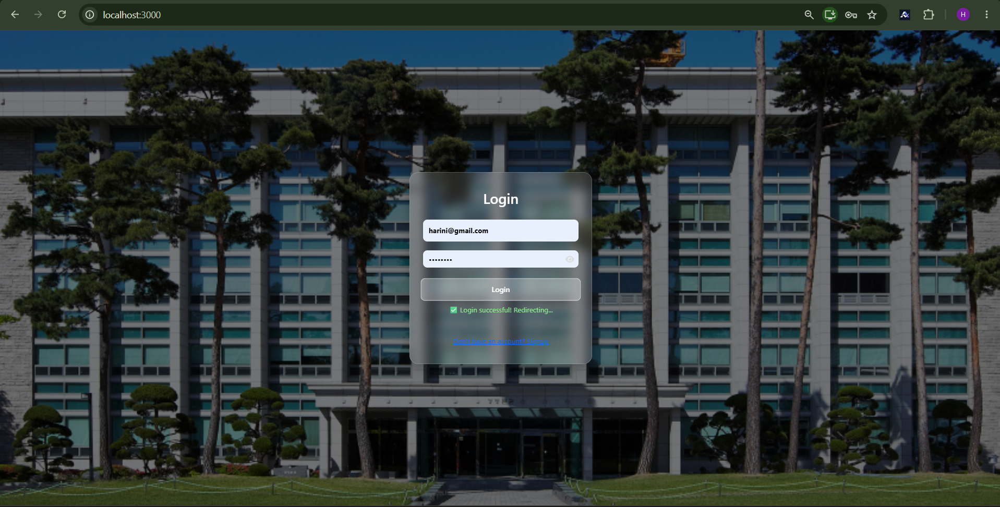
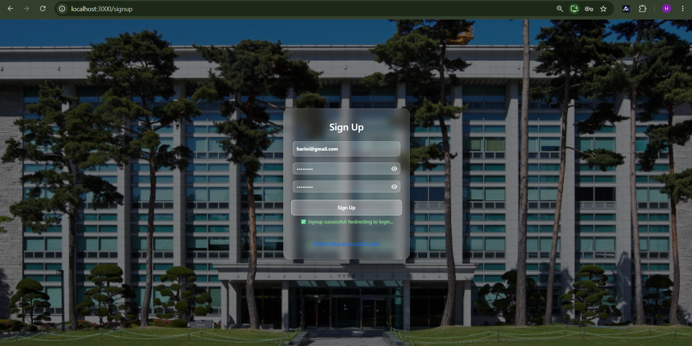
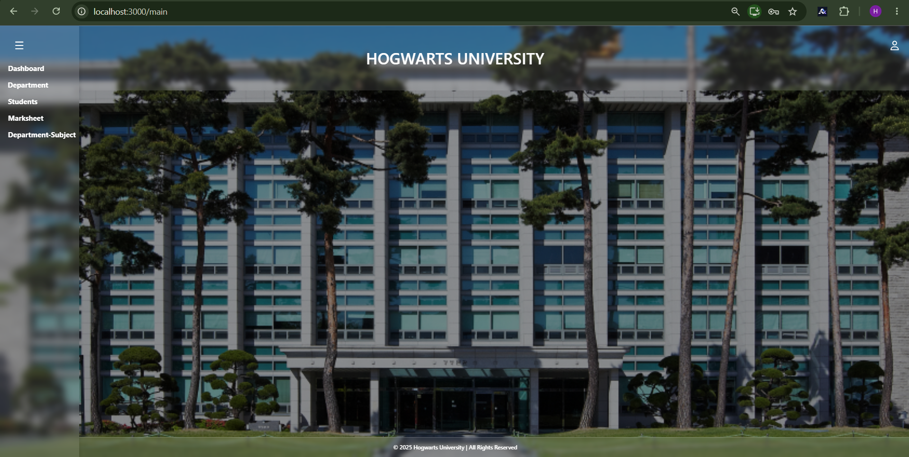
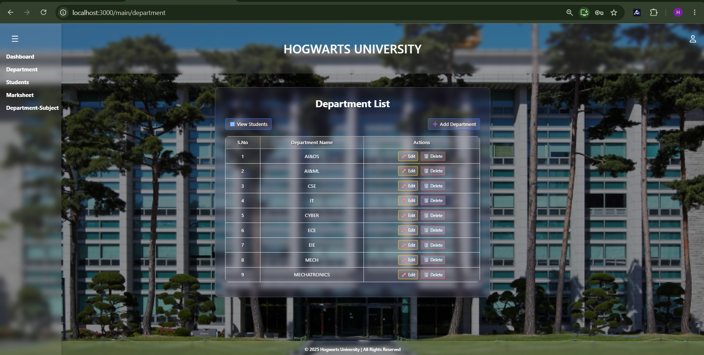
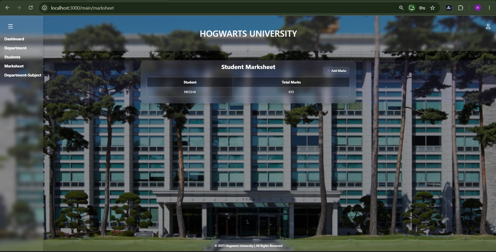
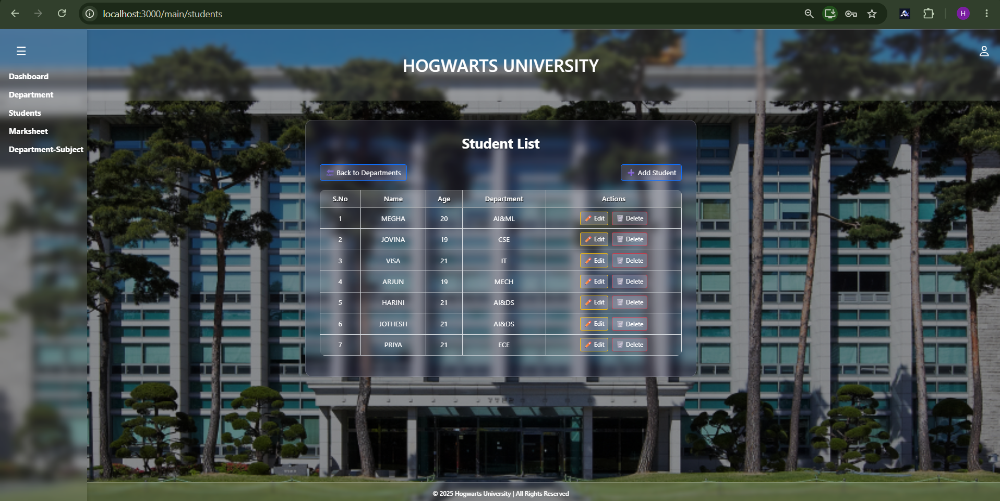
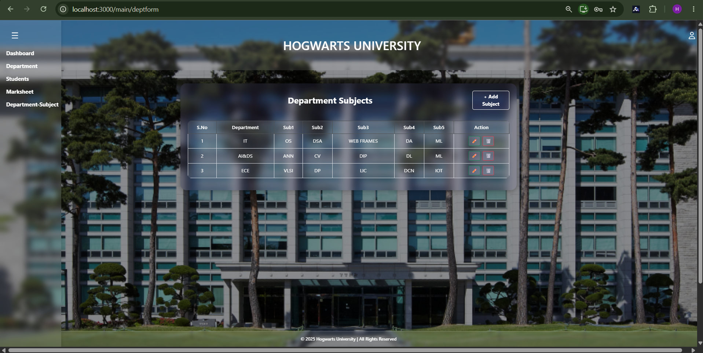

## 📸 Screenshots

### Login



### Signup


 
### Logout


### Homepage



### Dashboard


### Department



### Add Department


### Marksheet


### Add Marksheet


### Student


### Add Student


### Subject


### Add Subject


### Swagger Up


### Swagger Down


### MySQL Database
.png)

# 🎓 College Management System

A web-based application for managing college student records and academic information efficiently.

## ✨ Features

- User Login and Signup
- Dashboard
- Student Management
- Department Management
- Subject Management
- Marksheet Management
- MySQL Database Integration
- Swagger API Documentation

## 🛠️ Technologies Used

- **Frontend:** React
- **Backend:** Python *(confirm framework)*
- **Database:** MySQL
- **API Documentation:** Swagger

## 🚀 Getting Started

### 1. Clone the Repository

```bash
git clone https://github.com/10-harini/College-Management-System.git
```

### 2. Navigate to the Project Folder

```bash
cd College-Management-System
```

### 3. Install Frontend Dependencies

Navigate to the frontend directory containing `package.json` and run:

```bash
npm install
```

### 4. Configure the Backend

Configure the backend and MySQL database according to the project settings. Start the frontend and backend using their respective commands.

## 🎯 Project Objective

To simplify the management of student details and academic records through a centralized application.

## 👩‍💻 Author

**Harini S.**

GitHub: https://github.com/10-harini
